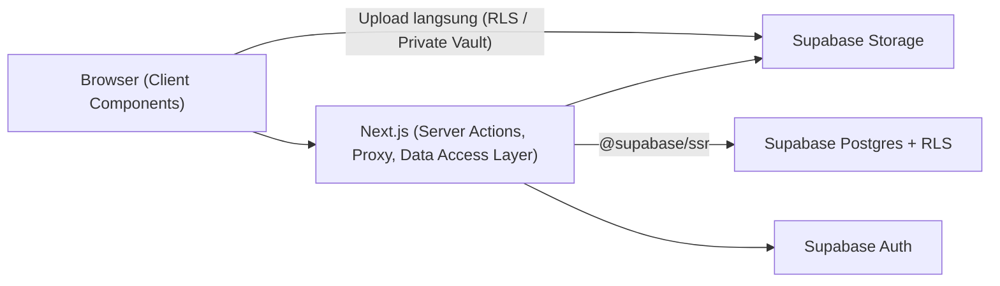

# Studika - Academic Companion Web App

Aplikasi web pendamping akademik cerdas untuk mahasiswa, dirancang untuk mendukung fokus belajar, pengelolaan jadwal & tugas, vault materi berkas (PDF & foto catatan papan tulis), serta interaksi dengan Tutor AI Akademik etis.

Implementasi antarmuka mengadopsi sistem desain **Warm Editorial Focus** dari **Google Stitch** (Project ID: `17481662600757458564`), terintegrasi penuh dengan **Supabase** (Auth, Database Postgres + RLS, dan Storage Buckets).

---

## 🎨 Layar & Navigasi (5 Screens)

| # | Halaman | Route | Deskripsi |
|---|---|---|---|
| 1 | **Login Studika** | `/login` | Form autentikasi dengan deteksi domain institusi (`.ac.id`, `.edu`), live password strength meter, Remember Me, login/register mode toggle, Google Education SSO, dan proteksi sesi cookie-based. |
| 2 | **Beranda Dashboard** | `/beranda` | Sapaan personal berdasar profil Supabase, progress bar target belajar harian terintegrasi checklist, aksi cepat, countdown ujian 72 jam, timeline jadwal hari ini, checklist tugas prioritas, dan tips mindful. |
| 3 | **Materi & Vault Berkas** | `/materi` | Pusat vault materi dengan dropzone upload langsung dari browser ke Supabase Storage (RLS terisolasi), filter koleksi, kartu dokumen dengan signed URL privat, preview thumbnail foto catatan, dan download/hapus berkas. |
| 4 | **Tutor AI Akademik** | `/tutor-ai` | Antarmuka obrolan tutor 24/7 dengan persistensi riwayat ke tabel `chat_sessions` & `chat_messages`, prompt chips inspirasi, respons terstruktur (poin ringkasan, tabel komparasi, formula box), input pesan, dan voice toggle. |
| 5 | **Jadwal & Tugas** | `/jadwal` | Switcher tampilan (Jadwal Mingguan vs Tugas & Ulangan), date strip kalender, kartu ujian mendesak countdown 72 jam, timeline jadwal kelas Senin, checklist tugas dengan Server Actions (tambah, centang selesai, hapus), modal tambah tugas, dan FAB radial menu. |

---

## 🏗️ Arsitektur Backend & Database

Tidak ada server backend terpisah. Aplikasi berjalan pada **Next.js App Router (Node.js runtime)** yang terhubung langsung ke **Supabase**:



| Kebutuhan | Solusi |
|---|---|
| Autentikasi | Supabase Auth via `@supabase/ssr` (cookie-based) dengan verifikasi `supabase.auth.getUser()` |
| Proteksi Rute | Next.js Proxy/Middleware (`src/proxy.ts` / `src/lib/supabase/middleware.ts`) |
| Baca Data | `src/lib/data/*` → Supabase Postgres dengan fallback lokal otomatis |
| Tulis Data (CRUD) | **Server Actions** (`src/lib/actions/*`) divalidasi dengan **Zod** |
| Upload Dokumen | **Langsung dari browser ke Supabase Storage** (tidak membebani server/Server Actions) |
| Keamanan Data | **Row Level Security (RLS)** aktif di seluruh tabel dan bucket storage |

---

## 🗄️ Skema Database & Storage

### 1. Tabel Database (`supabase/migrations/20261030000000_init_schema.sql`)
- `profiles`: `id` (PK → `auth.users`), `full_name`, `avatar_path`, `nim`, `program_studi`, `semester`, `created_at`, `updated_at`.
- `courses`: `id`, `user_id`, `name`, `code`, `lecturer`, `color`, `created_at`.
- `files`: `id`, `user_id`, `course_id`, `name`, `storage_path`, `mime_type`, `size_bytes`, `kind`, `created_at`.
- `schedules`: `id`, `user_id`, `course_id`, `day_of_week`, `start_time`, `end_time`, `room`, `created_at`.
- `tasks`: `id`, `user_id`, `course_id`, `title`, `description`, `due_at`, `priority`, `is_done`, `created_at`.
- `exams`: `id`, `user_id`, `course_id`, `title`, `scheduled_at`, `room`, `countdown_label`, `created_at`.
- `chat_sessions`: `id`, `user_id`, `title`, `created_at`.
- `chat_messages`: `id`, `session_id`, `user_id`, `role`, `content`, `attachment_file_id`, `created_at`.

### 2. Storage Buckets
| Bucket | Public? | Batas Ukuran | Format Berkas yang Diizinkan |
|---|---|---|---|
| `avatars` | Ya (Public) | 2 MB | JPEG, PNG, WebP |
| `vault` | **Tidak (Private)** | 25 MB | PDF, DOCX, PPTX, XLSX, TXT, JPEG, PNG, WebP |

> Seluruh berkas private dalam bucket `vault` disajikan melalui **Signed URL** berdurasi 1 jam yang dibuat secara dinamis dan aman.

---

## ⚙️ Konfigurasi Environment Variables

Salin `.env.example` menjadi `.env.local`:

```bash
cp .env.example .env.local
```

Isi dengan kredensial project Supabase Anda:

```env
# Dapatkan dari Supabase Dashboard -> Project Settings -> API
NEXT_PUBLIC_SUPABASE_URL=https://xxxxxxxxxxxx.supabase.co
NEXT_PUBLIC_SUPABASE_PUBLISHABLE_KEY=eyJh......

# Service Role Secret Key (Server only, jangan pernah NEXT_PUBLIC_)
SUPABASE_SECRET_KEY=eyJh......
```

> **Catatan Demo Mode**: Jika `.env.local` belum diisi kredensial Supabase, aplikasi tetap dapat dijalankan dan diuji tampilannya di `localhost` menggunakan dataset bawaan secara otomatis.

---

## 🚀 Panduan Menjalankan Migrasi & Menyalakan Localhost

### 1. Menjalankan Migrasi ke Supabase Cloud
1. Buka [Supabase Dashboard](https://supabase.com/dashboard) dan pilih project Anda.
2. Buka menu **SQL Editor**.
3. Buka file `supabase/migrations/20261030000000_init_schema.sql`, salin seluruh isinya, dan klik **Run**.
4. (Opsional) Buka file `supabase/seed.sql`, salin isinya, dan klik **Run** untuk memasukkan data awal demonstrasi.

### 2. Menjalankan Menggunakan Supabase CLI (Lokal dengan Docker)
Jika Anda memiliki Docker terpasang di komputer:
```bash
npx supabase start
npx supabase db reset   # Otomatis menjalankan migrations dan seed.sql
```

### 3. Instalasi Dependensi & Menjalankan Dev Server
```bash
# Pastikan dependensi terpasang
npm install

# Nyalakan server Next.js di localhost
npm run dev
```

Buka browser di **[http://localhost:3000](http://localhost:3000)**.
- Rute utama otomatis mengarahkan ke dashboard `/beranda`.
- Menu navigasi bawah memudahkan perpindahan antar 5 layar:
  - 🏠 **Beranda**: `/beranda`
  - 📂 **Materi & Vault**: `/materi`
  - 🤖 **Tutor AI**: `/tutor-ai`
  - 📅 **Jadwal & Tugas**: `/jadwal`
  - 🔑 **Login / Profil**: `/login` (klik avatar di pojok kanan atas untuk menu profil dan tombol keluar sesi).

---

## 🧪 Verifikasi Kualitas Kode

```bash
# Type check & optimized production build
npm run build

# Linter check (ESLint)
npm run lint
```
Semua perintah build dan lint terverifikasi 100% lulus tanpa error dan tanpa warning.
